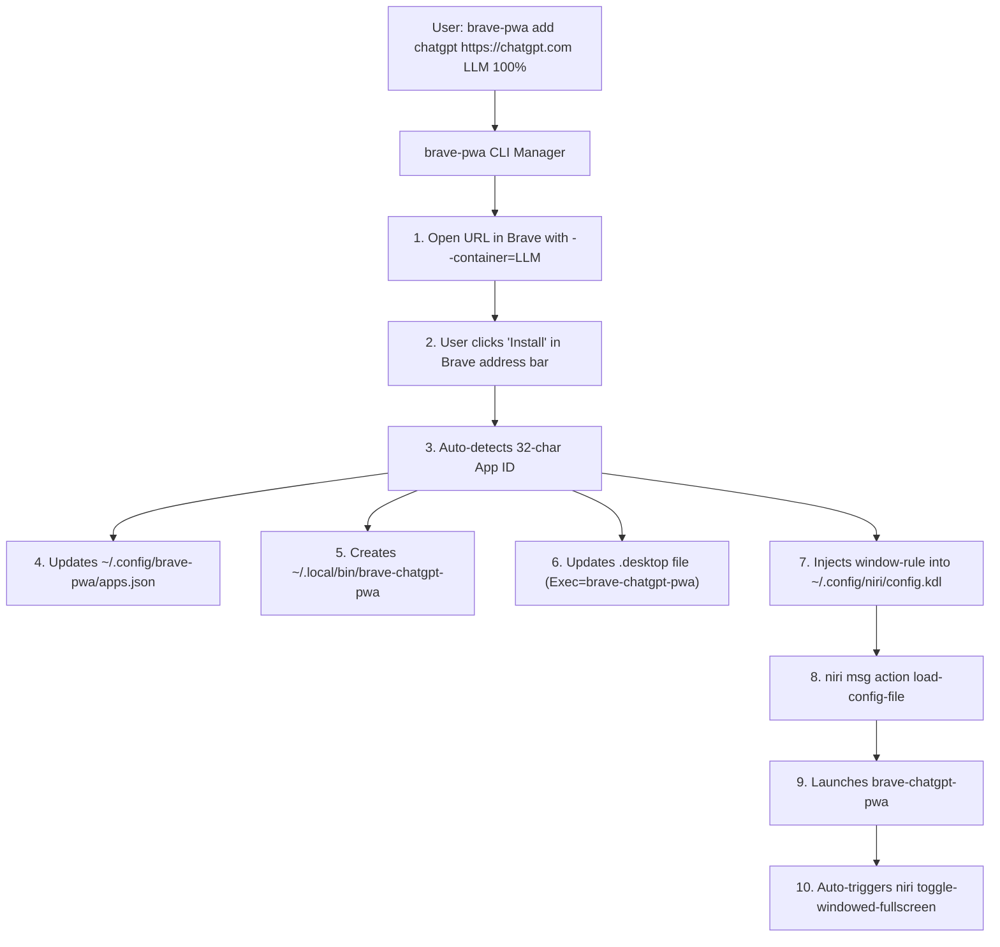

# brave-pwa-maker 🚀

[](#prerequisites)
[](https://github.com/YaLTeR/niri)
[](https://brave.com/)
[](LICENSE)

A unified CLI toolkit to create, configure, and manage **container-isolated**, **borderless**, and **tiled** Progressive Web Apps (PWAs) in the **Niri** Wayland compositor using **Brave Browser**.

---

## 🎯 The Motivation

### The Problem
* **Container Isolation in PWAs:** Brave offers powerful container isolation (similar to Firefox Multi-Account Containers), but when web apps are installed as PWAs, Brave's standard desktop shortcuts do not pass `--container=<Name>` flags.
* **Annoying Titlebars:** Under Wayland, Chromium/Brave PWA windows show persistent titlebars and header navigation frames. Enabling monitor-exclusive fullscreen hides status bars and breaks window tiling.
* **Repetitive Manual Setup:** Setting up each PWA requires installing the app, finding its 32-character hash ID, writing wrapper launcher scripts, modifying `.desktop` shortcuts, configuring compositor column widths, and binding Wayland IPC fullscreen triggers.

### The Solution: `brave-pwa-maker`
With **one single command**:
```bash
brave-pwa add chatgpt https://chatgpt.com LLM 100%
```
`brave-pwa-maker` launches the site in your chosen container, captures the official PWA App ID upon install, writes the custom executable symlink, syncs the desktop shortcut, injects the exact Niri column width rule, and automatically triggers Niri's `toggle-windowed-fullscreen` so the app is **100% borderless, perfectly tiled, and session-isolated**.

---

## ✨ Features

- ⚡ **One-Command Setup:** Create and register fully functional PWAs with a single CLI call.
- 🛡️ **Brave Container Isolation:** Isolate cookies, storage, and logins per container (e.g., `Social`, `LLM`, `Google`, `Work`, `Personal`).
- 🪟 **True Windowed Fullscreen:** Uses Niri's `toggle-windowed-fullscreen` action to strip away browser headers and window decorations while keeping the window tiled and your top bar visible.
- 📏 **Custom Column Widths:** Easily specify exact widths (e.g., `100%` for YouTube/GitHub, `33%` for companion apps like X/Reddit).
- 🎯 **Instant Single-Instance Focusing:** Re-launching an already-open PWA brings the existing window to focus instantaneously without duplicate windows or delay.
- 🖥️ **Full Desktop Integration:** Syncs `.desktop` files in `~/.local/share/applications` and `~/Desktop` with official high-resolution PWA icons.
- ⚙️ **Declarative JSON Configuration:** All apps are tracked in `~/.config/brave-pwa/apps.json` for easy scripting and backups.

---

## 📋 Prerequisites

1. **Linux** running Wayland.
2. **[Niri Compositor](https://github.com/YaLTeR/niri)** (version 25.0+ or 26.0+).
3. **[Brave Browser](https://brave.com/)** (installed at `/opt/brave.com/brave/brave-browser` or available in `$PATH`).
4. **Python 3.8+**.

---

## 📥 Installation

Clone the repository and run the installer:

```bash
git clone https://github.com/anonlegionoke/brave-pwa-maker.git
cd brave-pwa-maker
chmod +x install.sh
./install.sh
```

The installer will:
1. Copy `brave-pwa` and `brave-pwa-launcher` to `~/.local/bin/`.
2. Initialize `~/.config/brave-pwa/apps.json`.
3. Inject the PWA rule delimiters into `~/.config/niri/config.kdl`.
4. Add the default full-width rule for standard Brave windows.

> [!NOTE]
> Make sure `~/.local/bin` is in your shell's `$PATH` (e.g., `export PATH="$HOME/.local/bin:$PATH"` in `~/.bashrc` or `~/.zshrc`).

---

## 🚀 Usage

### 1. Create a New PWA (`brave-pwa add`)
```bash
brave-pwa add <name> <url> <container> [width] [--profile <profile_dir>]
```

#### Examples:
```bash
# Add ChatGPT in the 'LLM' container at full width
brave-pwa add chatgpt https://chatgpt.com LLM 100%

# Add Gmail in the 'Google' container at full width
brave-pwa add gmail https://mail.google.com Google 100%

# Add X (Twitter) in the 'Social' container at 33% width
brave-pwa add x https://x.com Social 33%

# Add Reddit in the 'Social' container at 33% width
brave-pwa add reddit https://www.reddit.com Social 33%
```

#### What happens during `add`:
1. Brave opens the target URL directly inside the specified container partition.
2. Click the **"Install"** icon in Brave's address bar (or `Menu ⋮` $\rightarrow$ *"Save and share"* $\rightarrow$ *"Install [Site] as app"*).
3. `brave-pwa` detects the newly generated App ID, wires up the desktop files, updates Niri rules, closes the unisolated initial window, and immediately relaunches your official containerized PWA.

---

### 2. List Configured Apps (`brave-pwa list`)
```bash
brave-pwa list
```

**Output Example:**
```text
Key          Name             Container    Width    App ID                            
--------------------------------------------------------------------------------------
chatgpt      ChatGPT          LLM          100%     cadlkienfkclaiaibeoongdcgmdikeeg  
github       GitHub           Personal     100%     mjoklplbddabcmpepnokjaffbmgbkkgg  
leetcode     LeetCode         Personal     100%     mdjegeaeedhanfmmokagnjngpeipkemo  
reddit       Reddit           Social       33%      lgnggepjiihbfdbedefdhcffnmhcahbm  
x            X                Social       33%      lodlkdfmihgonocnmddehnfgiljnadcf  
youtube      YouTube          YT           100%     agimnkijcaahngcdmfeangaknmldooml  
```

---

### 3. View Available Brave Containers (`brave-pwa containers`)
```bash
brave-pwa containers
```

Lists all configured containers in your Brave profile (e.g., `Personal`, `Work`, `Social`, `Google`, `Pro`, `LLM`, `YT`).

---

### 4. Remove a PWA (`brave-pwa remove`)
```bash
brave-pwa remove <name>
```

#### Example:
```bash
brave-pwa remove chatgpt
```
Cleans up the symlink from `~/.local/bin/`, deletes desktop files, removes the rule from Niri's `config.kdl`, and reloads the compositor.

---

### 5. Synchronize Rules & Shortcuts (`brave-pwa sync`)
```bash
brave-pwa sync
```
Re-synchronizes desktop shortcuts, Niri window rules, and application databases with the current contents of `apps.json`.

---

## 🏗️ Architecture & How It Works



### Key Components:
1. **`brave-pwa`:** Python management CLI for registering, auto-detecting, updating, and removing PWAs.
2. **`brave-pwa-launcher`:** The runtime dispatcher. When invoked as `brave-chatgpt-pwa`, it looks up `chatgpt` in `apps.json`, activates the container partition, checks if the window is already running (focusing it if so), launches Brave, and signals Niri via IPC to activate windowed fullscreen.
3. **`apps.json`:** Declarative manifest storing app keys, containers, official app IDs, custom widths, and command arguments.

---

## 🧩 Niri Compositor Integration

`brave-pwa-maker` inserts a managed block inside [`~/.config/niri/config.kdl`](file:///home/legio/.config/niri/config.kdl):

```kdl
// >>> BEGIN BRAVE PWA RULES >>>
window-rule {
    match app-id=r"^brave-.*(cadlkienfkclaiaibeoongdcgmdikeeg|(?i)chatgpt)"
    default-column-width { proportion 0.99999; }
}

window-rule {
    match app-id=r"^brave-.*(lodlkdfmihgonocnmddehnfgiljnadcf|(?i)x)"
    default-column-width { proportion 0.33333; }
}
// <<< END BRAVE PWA RULES <<<
```

And optionally binds a manual toggle key (e.g. `Mod+Alt+F`) in your `config.kdl`:
```kdl
// Toggle windowed (fake) fullscreen manually
Mod+Alt+F { toggle-windowed-fullscreen; }
```

---

## ⚠️ Known Limitations & Upstream Details

1. **Corner Radius in Windowed Fullscreen:**
   - In Niri 25.x / 26.x, activating `toggle-windowed-fullscreen` temporarily sets `geometry-corner-radius = 0` on the window (upstream issue [YaLTeR/niri#4050](https://github.com/YaLTeR/niri/issues/4050)). This is an intentional Wayland surface optimization in upstream Niri that will be addressed in future releases.
2. **One-Time Manual Install Click:**
   - Chromium security architecture requires an interactive user confirmation (clicking "Install") to create a formal PWA App ID with persistent container partitioning. The CLI automates everything before and after this single click.
3. **Multiple Chromium Sessions:**
   - Always ensure Brave is launched via the generated wrapper scripts so that the `--container` partition is bound before the tab attaches.

---

## 🗑️ Uninstallation

To remove `brave-pwa-maker`:

```bash
cd brave-pwa-maker
./uninstall.sh
```

To also delete your configuration (`~/.config/brave-pwa/`):
```bash
./uninstall.sh --purge
```

---

## 📄 License

Licensed under the [MIT License](LICENSE).
Created with ❤️ by [anonlegionoke](https://github.com/anonlegionoke).
